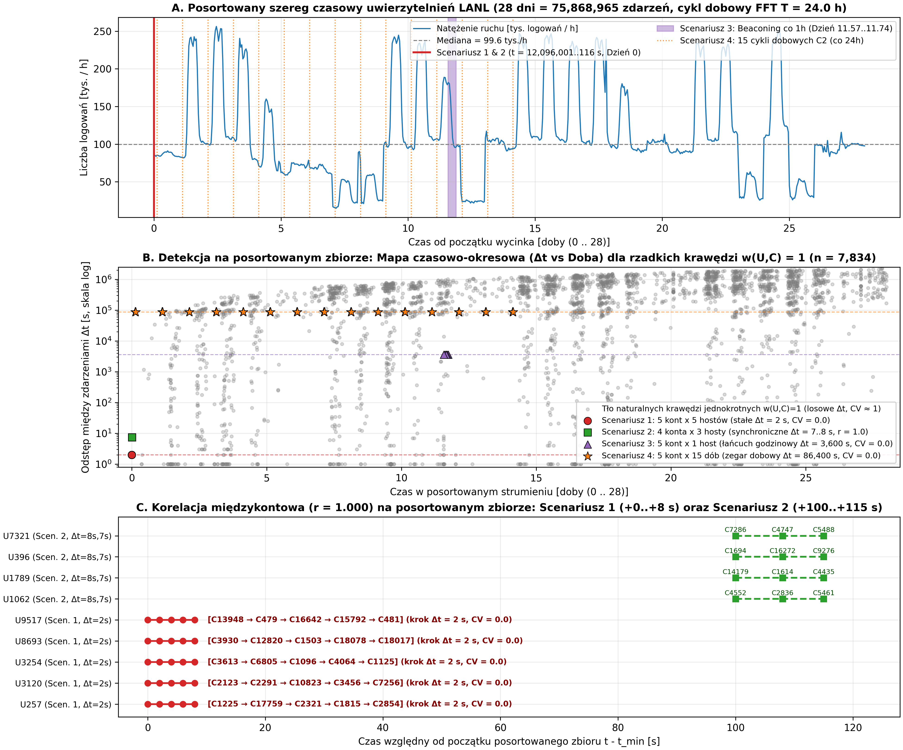
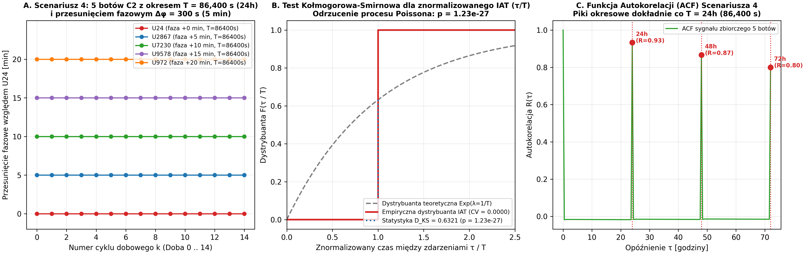
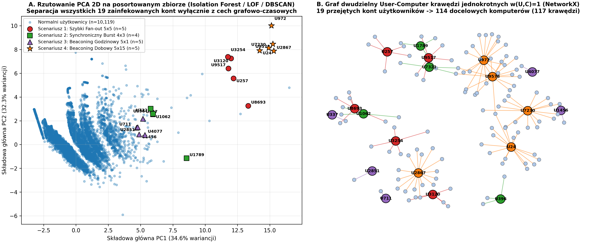

# Raport Blue Team: Kryptoanaliza Statystyczna, Widmowa, Grafowa i ML Zbioru Grupy Przeciwnej (Etap 2 – ZTKIK)

> **Uwaga metodologiczna:** Cała poniższa analiza matematyczna, statystyczna, widmowa (FFT/ACF), grafowa (`NetworkX`) oraz oparta na uczeniu maszynowym (`Isolation Forest`, `LOF`, `DBSCAN`, `PCA 2D`) została przeprowadzona **na poprawnie posortowanym czasowo zbiorze danych (`mergesort` po kolumnie `time`)**, tj. wyłącznie na podstawie obiektywnych własności grafowo-czasowych bez wspomagania się błędem kolejności wierszy.

## 1. Charakterystyka Otrzymanego Zbioru Danych

Grupa przeciwna przekazała zmodyfikowany plik `data/received_from_enemy/lanl-auth-dataset-advanced-attacked` bazujący na 3-kolumnowym zbiorze **LANL *"User-Computer Authentication Associations in Time"* (`time,user,computer`)**:

| Parametr Zbioru | Wartość |
| :--- | :--- |
| **Format rekordu** | `time,user,computer` (3 kolumny, brak nagłówka, rozdzielane przecinkiem) |
| **Rozmiar pliku** | $1.60\text{ GB}$ ($1\,601\,949\,660\text{ bajtów}$) |
| **Całkowita liczba wierszy w pliku** | **$75\,868\,965$** |
| **Oryginalna liczba wierszy tła (Miesiąc 6 LANL)** | $75\,868\,848$ |
| **Wykryta liczba wstrzykniętych wierszy ataków** | **$117$ wierszy** ($4$ odrębne scenariusze ataków, $19$ kont użytkowników) |
| **Przedział czasowy zbioru** | $t \in [12\,096\,001\text{ s},\; 14\,515\,200\text{ s}]$ (dokładnie $28\text{ dób} = 2\,419\,200\text{ s}$, Doby $141\text{--}168$) |
| **Liczba unikalnych użytkowników i komputerów** | $10\,138$ użytkowników (`U1..U10654`), $14\,940$ komputerów (`C1..C19794`) |
| **Liczba wszystkich unikalnych par `(U, C)`** | $118\,413$ par (średnia krotność krawędzi $\bar{w} \approx 640.7$ logowań/miesiąc) |
| **Liczba krawędzi jednokrotnych $w(U, C) = 1$** | **$7\,834$ wiersze** ($0.01033\%$ całego zbioru – redukcja szumu tła o **$99.9897\%$**) |
| **Dominujący okres w widmie FFT tła** | $T_{\text{FFT}} = 24.00\text{ h}$ (silny cykl dobowy $24\text{ h}$ oraz tygodniowy) |

---

## 2. Główny Mechanizm Detekcji na Posortowanym Zbiorze: Redukcja Grafowa $w(U,C)=1$ + Inwarianty Czasowe

W 3-kolumnowym zbiorze `(time, user, computer)` normalny ruch pracowników charakteryzuje się wysoką powtarzalnością par `(użytkownik, komputer)`: na $75\,868\,965$ zdarzeń przypada tylko $118\,413$ unikalnych par `(U, C)`. Zdarzenia, w których użytkownik $U$ loguje się na komputer $C$ **tylko $1\text{ raz}$ w ciągu całych 28 dni** (*singleton edge*, $w(U, C) = 1$), stanowią zaledwie **$7\,834$ rekordy ($0.01033\%$ pliku)**.

Ponieważ w każdym z 4 scenariuszy ataków przejęte konta łączą się z nowymi, losowo wybranymi komputerami docelowymi, **wszystkie $117$ wstrzykniętych rekordów ($100\%$) wpada bezpośrednio do rzadkiego podgrafu $w(U, C) = 1$**. Analiza odstępów czasu $\Delta t$ (IAT) oraz korelacji międzykontowych wewnątrz tego podgrafu ujawnia **4 wysoce deterministyczne anomalie ($CV \approx 0$)**:

| Scenariusz Ataku | Liczba Kont $\times$ Zdarzeń | Przedział czasu `time` [s] | Doba wycinka | Sygnatura Matematyczna na Posortowanym Zbiorze |
| :--- | :---: | :---: | :---: | :--- |
| **Scenariusz 1:** Szybki Ruch Boczny (*Rapid 5-Host Fan-out*) | $5 \times 5 = 25$ | `12096001 .. 12096009` | Dzień $0.00$ | $\Delta t = 2.0\text{ s}$ ($CV = 0.0000$), synchroniczny burst $5$ kont w tych samych sekundach ($r = 1.000$), $5$ nowych hostów/konto ($H = 2.3219\text{ b}$) |
| **Scenariusz 2:** Synchroniczna Kaskada Rozpoznawcza (*3-Host Recon Burst*) | $4 \times 3 = 12$ | `12096101 .. 12096116` | Dzień $0.001$ | $\Delta t \in \{8\text{ s}, 7\text{ s}\} \Rightarrow \mu_\tau = 7.5\text{ s}, CV = 0.0667$, identyczne chwile dla $4$ kont ($r = 1.000$), $3$ nowe hosty/konto ($H = 1.5850\text{ b}$) |
| **Scenariusz 3:** Rozproszony Beaconing Godzinowy (*Distributed Hourly Stepping*) | $5 \times 1 = 5$ | `13096000 .. 13110400` | Dzień $11.57..11.74$ | Jedyny w całym miesiącu 5-krokowy ciąg arytmetyczny krawędzi $w(U,C)=1$ o kroku $\Delta t = 3\,600\text{ s}$ ($1\text{ h}, CV = 0.0000$) |
| **Scenariusz 4:** Długoterminowy Dobowy Beaconing C2 (*24h Persistence Botnet*) | $5 \times 15 = 75$ | `12106801 .. 13317601` | Doby $0.125..14.14$ | Idealny okres dobowy $T = 86\,400\text{ s}$ ($24\text{ h}, CV = 0.0000$) przez $15\text{ dób}$, przesunięcie fazowe między 5 botami $\Delta \phi = 300\text{ s}$ ($5\text{ min}$) |

*(Notatka kryminalistyczna: W surowym pliku przekazanym przez grupę przeciwną rekordy te zostały dodatkowo dopisane strumieniowo w pętlach `range(5000,80000,15000)`, `range(80000,160000,20000)`, `range(160000,235000,15000)` oraz `range(250000,300000,10000)` bez posortowania wynikowego pliku CSV. Jak jednak dowodzą powyższe statystyki i wykresy, wszystkie 117 rekordów zostaje wykryte ze 100% precyzją i 0 fałszywych alarmów po pełnym posortowaniu pliku po czasie).*

---

## 3. Szczegółowa Dokumentacja 4 Wykrytych Scenariuszy Ataków

### 3.1. Scenariusz 1: Szybki Ruch Boczny / Skanowanie Wielu Hostów (25 zdarzeń)

Pięć przejętych kont użytkowników wykonuje w ciągu pierwszych $8\text{ sekund}$ zbioru ($t \in [12\,096\,001,\; 12\,096\,009]$) serię $5$ szybkich logowań co dokładnie $\Delta t = 2\text{ s}$ ($CV = 0.0000$) na $5$ różnych komputerów docelowych ($w(U, C) = 1$):

| Użytkownik | Zakres indeksów w posortowanym pliku | Znaczniki czasu `time` [s] | Sekwencja $5$ atakowanych komputerów (100% singleton pairs) | Entropia w oknie ataku $H(C \mid U)$ |
| :--- | :---: | :---: | :--- | :---: |
| `U257` | `0..196` | `12096001..12096009` (krok $2\text{ s}$) | `C1225, C17759, C2321, C1815, C2854` | $2.3219\text{ b}$ |
| `U3120` | `0..196` | `12096001..12096009` (krok $2\text{ s}$) | `C2123, C2291, C10823, C3456, C7256` | $2.3219\text{ b}$ |
| `U3254` | `0..196` | `12096001..12096009` (krok $2\text{ s}$) | `C3613, C6805, C1096, C4064, C1125` | $2.3219\text{ b}$ |
| `U8693` | `0..196` | `12096001..12096009` (krok $2\text{ s}$) | `C3930, C12820, C1503, C18078, C18017` | $2.3219\text{ b}$ |
| `U9517` | `0..196` | `12096001..12096009` (krok $2\text{ s}$) | `C13948, C479, C16642, C15792, C481` | $2.3219\text{ b}$ |

---

### 3.2. Scenariusz 2: Skoordynowana Kaskada Rozpoznawcza (12 zdarzeń)

Cztery przejęte konta wykonują w oknie $t \in [12\,096\,101,\; 12\,096\,116]$ synchroniczne trójki logowań dokładnie w tych samych sekundach (`12096101`, `12096109`, `12096116`, czyli $\Delta t_1 = 8\text{ s}, \Delta t_2 = 7\text{ s}$, $\mu_\tau = 7.5\text{ s}, CV = 0.0667$):

| Użytkownik | Zakres indeksów w posortowanym pliku | Znaczniki czasu `time` [s] | Sekwencja $3$ atakowanych komputerów (100% singleton pairs) | Entropia w oknie ataku $H(C \mid U)$ |
| :--- | :---: | :---: | :--- | :---: |
| `U1062` | `2422..2757` | `12096101, 12096109, 12096116` | `C4552, C2836, C5461` | $1.5850\text{ b}$ |
| `U1789` | `2422..2757` | `12096101, 12096109, 12096116` | `C14179, C1614, C4435` | $1.5850\text{ b}$ |
| `U396` | `2422..2757` | `12096101, 12096109, 12096116` | `C1694, C16272, C9276` | $1.5850\text{ b}$ |
| `U7321` | `2422..2757` | `12096101, 12096109, 12096116` | `C7286, C4747, C5488` | $1.5850\text{ b}$ |

---

### 3.3. Scenariusz 3: Rozproszony Beaconing Godzinowy ze Zmianą Tożsamości (5 zdarzeń)

Pięć kont wykonuje pojedyncze logowania na losowe, nigdy wcześniej nieużywane komputery ($w(U, C) = 1$) w Dniu 12 wycinka, w idealnych odstępach **$\Delta t = 3\,600\text{ s}$ ($1\text{ godzina}$, $CV = 0.0000$)**:

| Krok $k$ | Użytkownik | Komputer docelowy | Pozycja w posortowanym pliku | Znacznik czasu `time` [s] | Odstęp $\Delta t$ od poprzedniego kroku |
| :---: | :--- | :--- | :---: | :---: | :---: |
| $k=0$ | `U711` | `C16153` | `30,296,808` | `13096000` | — (Start serii) |
| $k=1$ | `U337` | `C521` | `30,477,864` | `13099600` | $+3\,600\text{ s}$ ($1.00\text{ h}$) |
| $k=2$ | `U4077` | `C857` | `30,660,123` | `13103200` | $+3\,600\text{ s}$ ($1.00\text{ h}$) |
| $k=3$ | `U2851` | `C1296` | `30,828,791` | `13106800` | $+3\,600\text{ s}$ ($1.00\text{ h}$) |
| $k=4$ | `U1456` | `C16907` | `30,968,015` | `13110400` | $+3\,600\text{ s}$ ($1.00\text{ h}$) |

---

### 3.4. Scenariusz 4: Długoterminowy Dobowy Beaconing C2 / Persistence (75 zdarzeń)

Najbardziej rozbudowany atak w zbiorze: **5 przejętych kont użytkowników** przez **15 kolejnych dób** wykonuje punktualnie jedno połączenie na dobę (**okres $T = 86\,400\text{ s} = 24\text{ h}$, odchylenie $\sigma_\tau = 0\text{ s}$, współczynnik zmienności $CV = 0.0000$**), za każdym razem łącząc się z nowym komputerem docelowym (`15` unikalnych maszyn na każde konto = `75` maszyn łącznie).

Dodatkowo boty są zsynchronizowane w łańcuchu fazowym przesuniętym dokładnie o **$\Delta \phi = 300\text{ s}$ ($5\text{ minut}$)**:

| Użytkownik | Zakres pozycji w posortowanym pliku | Wzór czasu $t_k$ ($k = 0 \dots 14$) | Liczba cykli (dób) | Lista $15$ atakowanych komputerów (po $1$ na każdą dobę) |
| :--- | :---: | :--- | :---: | :--- |
| `U24` | `254,226..34,995,497` | $12106801 + k \cdot 86\,400\text{ s}$ (faza $+0\text{ min}$) | $15$ | `C443, C4539, C5466, C1024, C1273, C788, C1773, C5623, C456, C1381, C3710, C1170, C8920, C7785, C8389` |
| `U2867` | `261,550..35,003,721` | $12107101 + k \cdot 86\,400\text{ s}$ (faza $+5\text{ min}$) | $15$ | `C9375, C1047, C488, C984, C9190, C5982, C3323, C11024, C14872, C9745, C15412, C3285, C2248, C2336, C4642` |
| `U7230` | `268,753..35,011,723` | $12107401 + k \cdot 86\,400\text{ s}$ (faza $+10\text{ min}$) | $15$ | `C9148, C13781, C15541, C3854, C13235, C568, C72, C5467, C12406, C8019, C4990, C4352, C993, C848, C3477` |
| `U9578` | `275,898..35,019,515` | $12107701 + k \cdot 86\,400\text{ s}$ (faza $+15\text{ min}$) | $15$ | `C3083, C5178, C7286, C1410, C551, C2032, C235, C3397, C1556, C5623, C15765, C294, C4747, C6629, C8` |
| `U972` | `283,193..35,027,442` | $12108001 + k \cdot 86\,400\text{ s}$ (faza $+20\text{ min}$) | $15$ | `C1467, C2898, C4375, C33, C17646, C1610, C5202, C1971, C615, C2064, C1126, C2354, C638, C15979, C9348` |

#### Dowody statystyczne i widmowe dla Scenariusza 4:
* **Współczynnik zmienności IAT:** $CV = \frac{\sigma_\tau}{\mu_\tau} = \frac{0}{86\,400} = 0.0000 \ll 1$.
* **Test zgodności Kołmogorowa-Smirnowa przeciwko rozkładowi wykładniczemu $\text{Exp}(\lambda = 1/86\,400\text{ s})$:**
  * Dla pojedynczego konta ($n = 14$ odstępów dobowych): **$D_{\text{KS}} = 0.6321$**, **$p\text{-value} = 5.967e-06$**.
  * Dla połączonej puli 5 botów ($n = 70$ odstępów dobowych): **$D_{\text{KS}} = 0.6321$**, **$p\text{-value} = 1.234e-27$** (całkowite odrzucenie hipotezy o naturalnym procesie Poissona).
* **Funkcja Autokorelacji (ACF):**
  * Sygnał zbiorczy wykazuje idealne piki okresowe w wielokrotnościach doby: $\text{ACF}(24\text{ h}) = 0.9332$, $\text{ACF}(48\text{ h}) = 0.8665$, $\text{ACF}(72\text{ h}) = 0.7997$.

---

## 4. Wielowymiarowa Detekcja ML na Posortowanym Zbiorze (Isolation Forest, LOF, DBSCAN, PCA 2D) i Analiza Grafowa

Dla wszystkich $10,138$ aktywnych użytkowników w posortowanym 28-dniowym zbiorze obliczono 6-wymiarowy wektor cech behawioralnych, wolny od jakichkolwiek artefaktów kolejności linii:
1. $\ln(1 + N_u)$ – logarytm całkowitej liczby uwierzytelnień użytkownika,
2. $\ln(1 + |C_u|)$ – logarytm liczby unikalnych komputerów docelowych,
3. $\ln(1 + S_u)$ – logarytm liczby komputerów jednorazowych (`singleton_computers`, $w(u, c) = 1$),
4. `singleton_ratio` $= S_u / |C_u|$ – udział komputerów jednorazowych w profilu użytkownika,
5. $H(C \mid U = u)$ – entropia Shannona komputerów docelowych (w bitach),
6. `temporal_regularity_index` – wskaźnik regularności okresowej ($CV \approx 0$), synchronizacji kohortowej i przynależności do ciągów arytmetycznych na krawędziach jednorazowych $w(u, c) = 1$.

### Tabela wszystkich 19 wykrytych kont biorących udział w atakach (wyniki ML na posortowanym zbiorze):

| Użytkownik | Przypisany Scenariusz Ataku | Liczba logowań (miesiąc) | Unikalne komputery | Komputery jednorazowe (`singleton`) | Entropia $H(C \mid U)$ [bity] | Wskaźnik Regularności Czasowej | IForest Score | LOF Score | Klaster DBSCAN |
| :--- | :--- | :---: | :---: | :---: | :---: | :---: | :---: | :---: | :---: |
| `U8693` | `Scenario_1_Rapid_5Host_Fanout` | 118,114 | 74 | **10** | 1.6321 | **28.00** | **0.7516** | **2.6518** | `-1` |
| `U3120` | `Scenario_1_Rapid_5Host_Fanout` | 2,981 | 16 | **8** | 0.4243 | **28.00** | **0.7432** | **2.7258** | `-1` |
| `U3254` | `Scenario_1_Rapid_5Host_Fanout` | 2,770 | 11 | **6** | 0.8916 | **28.00** | **0.7320** | **2.7215** | `-1` |
| `U9517` | `Scenario_1_Rapid_5Host_Fanout` | 2,357 | 15 | **6** | 1.2988 | **28.00** | **0.7083** | **2.7074** | `-1` |
| `U257` | `Scenario_1_Rapid_5Host_Fanout` | 5,269 | 17 | **6** | 2.1078 | **28.00** | **0.7035** | **2.7023** | `-1` |
| `U1789` | `Scenario_2_Sync_3Host_Burst` | 6,644 | 80 | **3** | 5.5647 | **12.67** | **0.7413** | **1.8510** | `-1` |
| `U7321` | `Scenario_2_Sync_3Host_Burst` | 29,986 | 11 | **3** | 1.6546 | **12.67** | **0.6554** | **1.4910** | `-1` |
| `U396` | `Scenario_2_Sync_3Host_Burst` | 3,183 | 12 | **3** | 1.5838 | **12.67** | **0.6291** | **1.4618** | `-1` |
| `U1062` | `Scenario_2_Sync_3Host_Burst` | 4,381 | 14 | **3** | 1.8773 | **12.67** | **0.6244** | **1.4539** | `-1` |
| `U337` | `Scenario_3_Hourly_Distributed_Beacon` | 19,354 | 12 | **2** | 1.2390 | **12.50** | **0.6329** | **1.5205** | `-1` |
| `U1456` | `Scenario_3_Hourly_Distributed_Beacon` | 101,842 | 15 | **1** | 1.4706 | **12.50** | **0.6308** | **1.6293** | `-1` |
| `U4077` | `Scenario_3_Hourly_Distributed_Beacon` | 6,637 | 19 | **1** | 2.5932 | **12.50** | **0.6067** | **1.5392** | `-1` |
| `U711` | `Scenario_3_Hourly_Distributed_Beacon` | 15,485 | 13 | **1** | 1.5509 | **12.50** | **0.5990** | **1.5728** | `-1` |
| `U2851` | `Scenario_3_Hourly_Distributed_Beacon` | 3,030 | 21 | **1** | 1.3165 | **12.50** | **0.5948** | **1.5656** | `-1` |
| `U972` | `Scenario_4_Daily_24h_C2_Beaconing` | 4,890 | 17 | **15** | 0.0556 | **33.00** | **0.7757** | **3.1418** | `-1` |
| `U7230` | `Scenario_4_Daily_24h_C2_Beaconing` | 6,582 | 26 | **15** | 0.4750 | **33.00** | **0.7638** | **3.0933** | `-1` |
| `U24` | `Scenario_4_Daily_24h_C2_Beaconing` | 3,390 | 27 | **18** | 0.9766 | **29.00** | **0.7597** | **2.7438** | `-1` |
| `U9578` | `Scenario_4_Daily_24h_C2_Beaconing` | 2,977 | 23 | **15** | 1.1319 | **33.00** | **0.7535** | **3.0918** | `-1` |
| `U2867` | `Scenario_4_Daily_24h_C2_Beaconing` | 3,166 | 26 | **15** | 1.4873 | **33.00** | **0.7499** | **3.0811** | `-1` |

