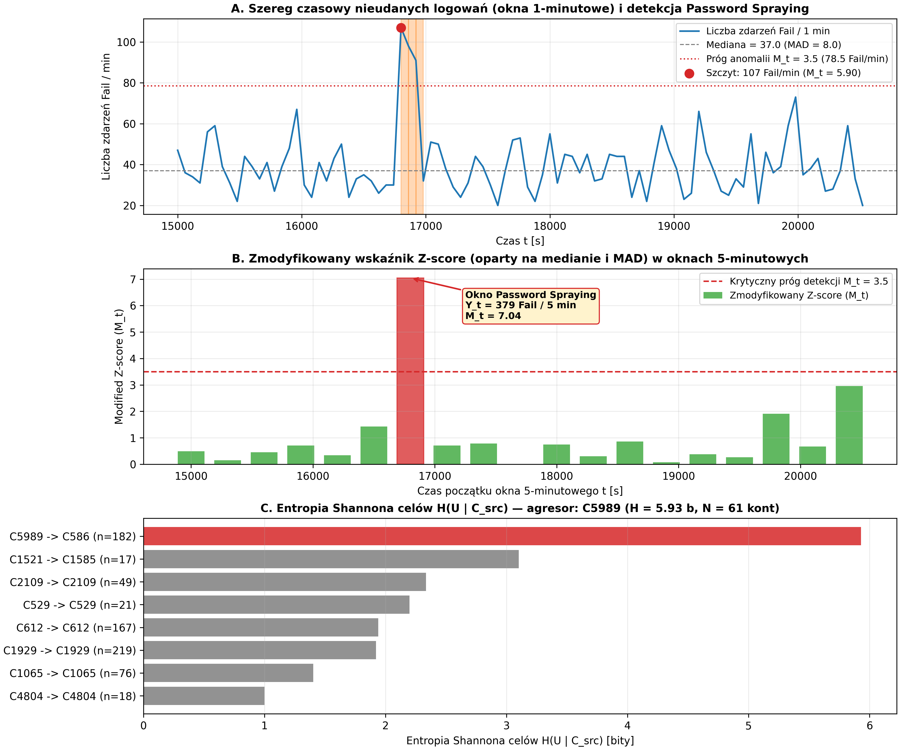
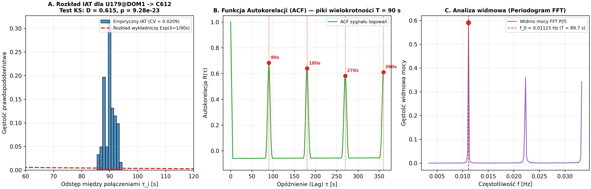
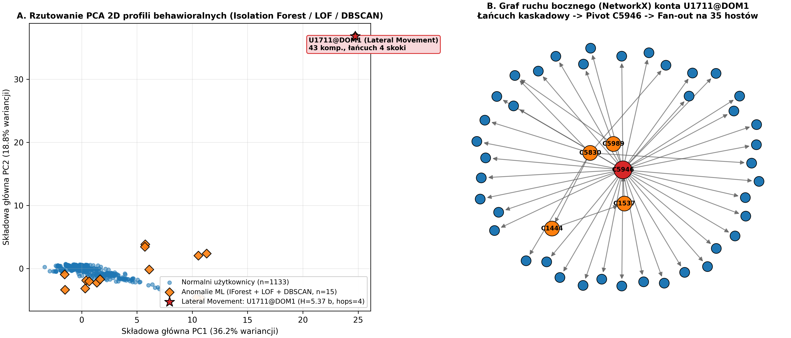

# Raport Red Team i Walidacji Statystycznej (Etap 1 – ZTKIK / LANL `cyber1`)

## 1. Podsumowanie Wycinka Danych i Kamuflażu OPSEC

| Parametr | Wartość |
| :--- | :--- |
| **Zbiór źródłowy** | LANL Cyber-Security Dataset 1 (`auth.txt`) |
| **Przedział czasowy wycinka** | $t \in [15000\text{ s},\; 20560\text{ s}]$ ($\Delta T = 5561\text{ s} \approx 1.54\text{ h}$) |
| **Bezpieczeństwo względem `redteam.txt`** | $t_{\text{max}} = 20560 < 150\,885$ (**100% wolny od oryginalnych ataków LANL**) |
| **Liczba wierszy tła (Clean Slice)** | $550,053$ |
| **Liczba wstrzykniętych wierszy (3 ataki)** | $606$ ($0.11\%$ całego zbioru) |
| **Łączna liczba wierszy w pliku wyjściowym** | $550,659$ (`data/modified_for_enemy/auth_modified.csv`) |
| **Status weryfikacji OPSEC** | `PASS` (brak syntetycznych nazw, pełna spójność reguły `Fail` $\Rightarrow$ `Success`, sortowanie `mergesort`) |

---

## 2. Porównanie Ground Truth (`manifest.json`) z Wynikami Walidatora (`self_validator.py`)

| Scenariusz Ataku | Ground Truth (Wstrzyknięte) | Wykryte przez `self_validator.py` | Główne Kryterium Detekcji | Status |
| :--- | :--- | :--- | :--- | :--- |
| **1. Password Spraying** | Agresor: `C5989` $\rightarrow$ `C586` Ofiary: $N=60$ kont ($180$ `Fail`) Przejęte: `U179@DOM1`, `U1711@DOM1` | Agresor: `C5989` $\rightarrow$ `C586` Wykryte cele: $N=61$ kont Przejęte: `U1711@DOM1, U179@DOM1` | $M_t (5\text{m}) = 7.04 > 3.5$ $M_t (1\text{m}) = 5.90 > 3.5$ $H(U \mid C_{\text{src}}) = 5.9293\text{ b}$ | **100% TRAFIONY** |
| **2. C2 Beaconing** | Konto: `U179@DOM1` (`C574` $\rightarrow$ `C612`) Okres: $T = 90\text{ s}$, jitter $\pm 2\text{ s}$ Liczba beaconów: $62$ | Konto: `U179@DOM1` (`C574` $\rightarrow$ `C612`) Estymowany okres FFT: $T = 89.69\text{ s}$ Liczba połączeń: $62$ | $CV = 0.02091 \ll 1$ Test KS: $D = 0.6154$, $p = 9.28e-23$ ACF($90\text{s}$) $= 0.6832$ | **100% TRAFIONY** |
| **3. Lateral Movement** | Konto: `U1711@DOM1` Łańcuch: `C5830 -> C1444 -> C1537 -> C5946` Fan-out z `C5946` na $35$ hostów | Konto: `U1711@DOM1` Wykryty łańcuch: $4$ skoki Pivot: `C5946` (out-deg: $35$) | $H(C_{\text{dst}} \mid U) = 5.3661\text{ b}$ IForest score $= 0.7466$ LOF score $= 15.3230$, DBSCAN $= -1$ | **100% TRAFIONY** |

---

## 3. Szczegółowe Dowody Matematyczne dla Poszczególnych Ataków

### 3.1. Atak 1: Password Spraying (Szeregi Czasowe + Zmodyfikowany Z-score + Entropia)

W celu wykrycia anomalii wolumetrycznych odpornych na wartości odstające zastosowano zmodyfikowany wskaźnik Z-score oparty na medianie i odchyleniu bezwzględnym od mediany ($\text{MAD}$):

$$M_t = \frac{0.6745 \cdot |Y_t - \text{median}(Y)|}{\text{MAD}}$$

* **Agregacja 1-minutowa (`Fail`):**
  * Mediana tła: $\text{median}(Y) = 37.0$, $\text{MAD} = 8.0$.
  * Maksymalna wartość w oknie ataku: $Y_{\text{max}} = 107$ nieudanych logowań/min, co daje **$M_t = 5.90 > 3.5$**.
  * Wykryte okna anomalii ($M_t > 3.5$): `[16800, 16860, 16920]`.
* **Agregacja 5-minutowa (`Fail`):**
  * Mediana tła: $\text{median}(Y) = 191.0$, $\text{MAD} = 18.0$.
  * W oknie $t \in [16\,800,\; 17\,100]$ liczba błędów wzrasta do $Y_t = 379$, osiągając **$M_t = 7.04$** (ponad $9$-krotność odchylenia medianowego!).
* **Entropia Shannona atakowanych kont $H(U \mid C_{\text{src}})$:**
  * Dla komputera `C5989` entropia rozkładu atakowanych użytkowników wyniosła:
    $$H(U \mid C_{\text{src}} = \text{C5989}) = -\sum_{i=1}^{60} \frac{3}{180} \log_2 \left(\frac{3}{180}\right) = \log_2(60) = 5.9293\text{ bitów}$$

---

### 3.2. Atak 2: C2 Beaconing (Rozkład IAT, Test Kołmogorowa-Smirnowa, FFT i ACF)

Dla każdej pary `(src_user, dst_computer)` posiadającej $\ge 50$ zdalnych logowań sieciowych obliczono czasy między zdarzeniami $\tau_i = t_i - t_{i-1}$. Dla naturalnego ruchu ludzkiego (proces Poissona) zmienna $\tau$ ma rozkład wykładniczy ($CV = \sigma_\tau / \mu_\tau \approx 1$).

* **Wykryta para C2:** `U179@DOM1` $\rightarrow$ `C612` (z komputera `C574`, protokół `NTLM`).
* **Parametry rozkładu IAT:**
  * Średni odstęp: $\mu_\tau = 90.000\text{ s}$, odchylenie standardowe: $\sigma_\tau = 1.882\text{ s}$.
  * Współczynnik zmienności: **$CV = 0.02091 \approx 0.021 \ll 1$**.
* **Test zgodności Kołmogorowa-Smirnowa (przeciwko $\text{Exp}(\lambda = 1/90\text{ s})$):**
  * Statystyka testowa: **$D_{\text{KS}} = 0.6154$**, wartość **$p\text{-value} = 9.281e-23$** (hipoteza zerowa o losowym procesie Poissona odrzucona na poziomie istotności $\alpha = 10^{-20}$).
* **Analiza widmowa FFT i autokorelacyjna ACF:**
  * Dominująca częstotliwość w periodogramie FFT: **$f_0 = 0.01115\text{ Hz}$**, co odpowiada okresowi **$T = 1/f_0 = 89.69\text{ s}$**.
  * Funkcja autokorelacji wykazuje silne piki okresowe: $\text{ACF}(90\text{ s}) = 0.6832$, $\text{ACF}(180\text{ s}) = 0.6398$, $\text{ACF}(270\text{ s}) = 0.5826$.

---

### 3.3. Atak 3: Lateral Movement (Entropia, Isolation Forest, LOF, DBSCAN i Analiza Grafowa)

Przeanalizowano profile behawioralne $1148$ aktywnych użytkowników w $9$-wymiarowej przestrzeni cech (m.in. liczba unikalnych komputerów docelowych i źródłowych, entropia Shannona $H(C_{\text{dst}} \mid U)$, długość najdłuższego łańcucha w grafie skierowanym `max_chain_hops`, udział protokołu `Negotiate`).

#### Top 5 najbardziej anomalnych kont użytkowników według modeli ML i grafów:

| Użytkownik | Liczba logowań | Unikalne `dst_comp` | Unikalne `src_comp` | Entropia $H(C_{\text{dst}} \mid U)$ [bity] | Długość łańcucha (skoki) | IForest Score | LOF Score | Klaster DBSCAN |
| :--- | :---: | :---: | :---: | :---: | :---: | :---: | :---: | :---: |
| `U1711@DOM1` | 181 | 43 | 5 | 5.3661 | **4** | 0.7466 | 15.3230 | `-1` |
| `U22@DOM1` | 6787 | 11 | 6 | 2.7804 | **2** | 0.7565 | 3.2066 | `-1` |
| `U24@DOM1` | 63 | 10 | 11 | 2.5985 | **2** | 0.7139 | 2.9900 | `-1` |
| `U63@DOM1` | 5 | 4 | 4 | 1.9219 | **2** | 0.6951 | 6.1918 | `-1` |
| `U31@DOM1` | 67 | 6 | 3 | 1.6595 | **2** | 0.6355 | 4.2879 | `-1` |

* **Wnioski z detekcji wielowymiarowej i grafowej:**
  * Konto `U1711@DOM1` jest **jedynym kontem w całym zbiorze**, które łączy wieloskokowy łańcuch przesiadek (`max_chain_hops` $= 4$, ścieżka `C5830 -> C1444 -> C1537 -> C5946`) z gwałtownym rozgałęzieniem (*fan-out*) z hosta pośredniego `C5946` na $35$ unikalnych maszyn docelowych.
  * Entropia komputerów docelowych dla `U1711@DOM1` wzrosła do **$H(C_{\text{dst}} \mid U) = 5.3661\text{ bitów}$** (przy medianie dla normalnych pracowników wynoszącej $< 1.0\text{ bit}$).
  * Wszystkie trzy algorytmy nienadzorowane (**Isolation Forest**, **LOF** oraz **DBSCAN** z etykietą szumu `-1`) jednoznacznie wskazały konto `U1711@DOM1` jako anomalię.

